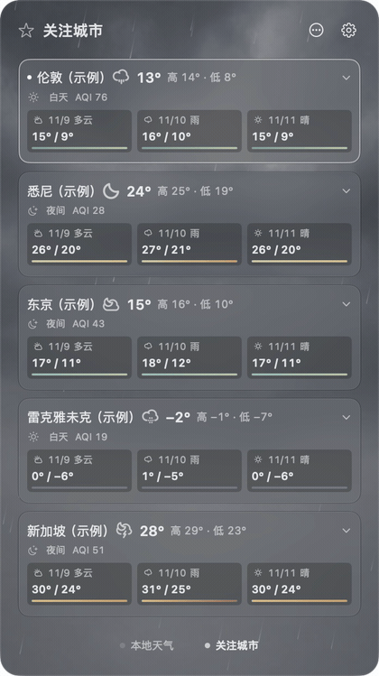
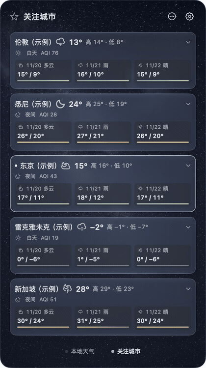
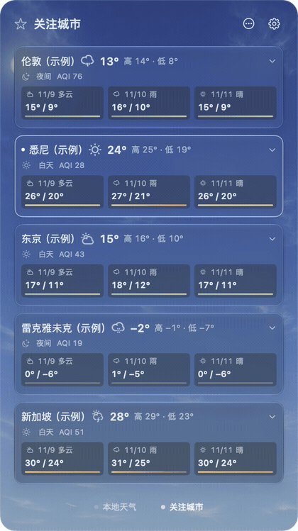
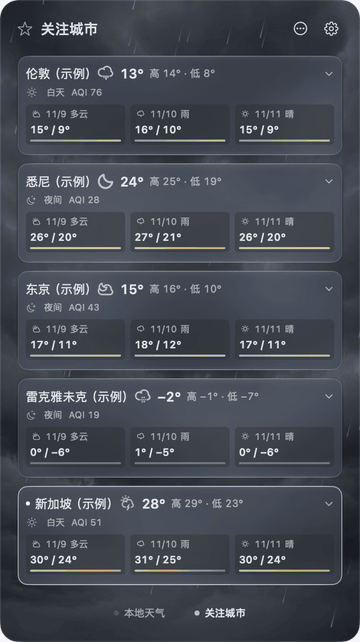
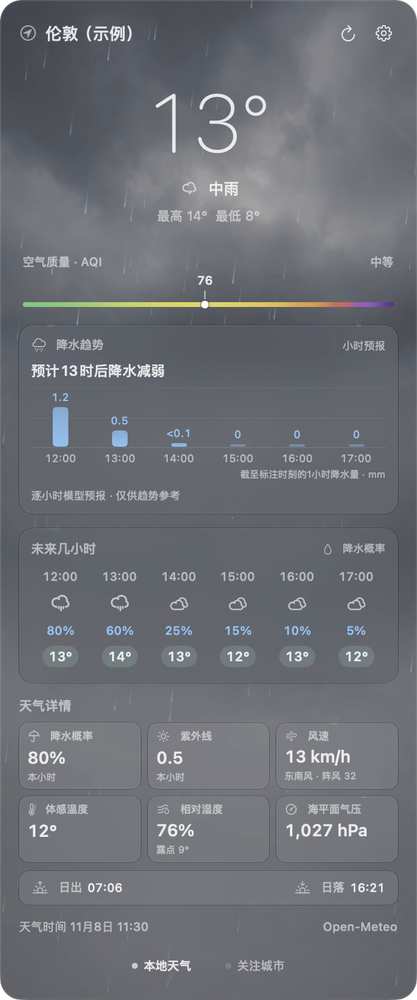
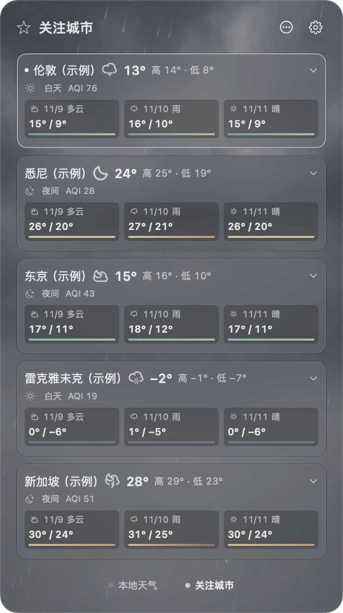
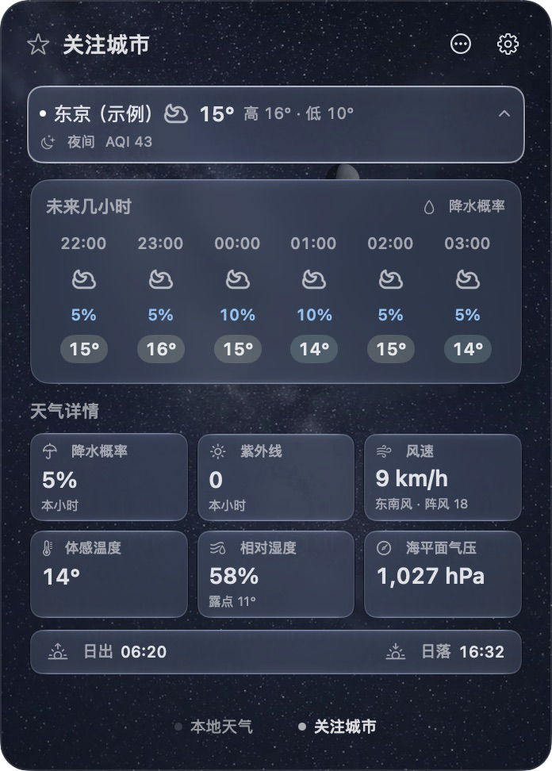

# 天气菜单栏 V2.0 · Weather Menu Bar

原生 macOS 菜单栏天气应用：一眼看天气、温度与穿搭，展开查看完整天气和关注城市。

A native macOS menu bar app for weather, temperature and clothing suggestions, with detailed forecasts and followed cities.

**macOS 26+ · Apple Silicon · 2.0.0（build 28）**

[源码版本 / Source release](https://github.com/tigercong2021/weather-menubar/releases/tag/v2.0.0) · [更新记录 / Changelog](CHANGELOG.md)

## V2.0 更新 / What's new since 1.0.1

| 中文 | English |
| --- | --- |
| **逐小时降水**：未来六个小时段分别显示降水概率，新增小时趋势图与简短摘要。 | **Hourly precipitation:** probabilities for the next six hourly intervals, plus a precipitation chart and summary. |
| **整页天气与玻璃界面**：动态天空配合风向驱动的雨雪、溅水、雾与雷电，昼夜有不同氛围。 | **Weather across the panel:** glass surfaces, moving skies, wind-driven precipitation, splashes, fog and lightning, with distinct day/night scenes. |
| **穿搭与天气提醒**：新增菜单栏服装图标；悬停显示简短穿搭与体感温度，特定较强天气追加一句提醒。 | **Clothing hints:** a garment icon and compact hover advice based on apparent temperature, with an extra note for certain severe conditions. |
| **区县定位**：主城可显示“上海·青浦区”等名称，移动后确认更新；也可手动选择城市。 | **District-aware location:** more precise place labels and confirmed updates as you move, with manual city selection available. |
| **当地 AQI 色带**：连续无刻度渐变按主城过去 12 个完整月的分布调整宽度，指数分类不变。 | **Locally adapted AQI:** a smooth, tick-free scale sized using the preceding 12 complete months; AQI categories stay unchanged. |
| **关注页重做**：紧凑卡片、所选城市整页背景、独立详情；再点摘要回列表。列表自然增高，屏幕放不下才分页。 | **Redesigned followed cities:** compact cards, selected-city backgrounds and dedicated details. Click the summary again to return; the list grows naturally and paginates only when needed. |
| **日月与亮星**：按城市与当前时刻在本机计算太阳、月亮、月相及预计最亮星点，低于地平线隐藏。 | **Sun, moon and bright object:** positions and lunar phase calculated locally for the current place and time; objects below the horizon are hidden. |

## 动效 / Motion

关注城市的原生动态天气背景。城市从世界各地选取作为随机示例，天气与时间均为展示数据，不使用真实定位或个人关注列表。

Native animated backgrounds on the followed-cities page. Cities are random examples from around the world; all weather and times are demonstration data, without real location or personal followed-city data.

| 雨天 · Rain | 夜空 · Night |
| --- | --- |
|  |  |
| 晴天 · Sun | 雷雨 · Thunder |
|  |  |

## 界面 / Screenshots

| 本地天气 · Local weather | 关注城市 · Followed cities |
| --- | --- |
|  |  |
| 城市详情 · City details | 穿搭提示 · Clothing hint |
|  |  |

截图为原生界面，使用示例天气数据。 / Native UI with sample weather data.

## 使用与构建 / Use and build

点击菜单栏天气打开面板，底部切换本地天气与关注城市。最多关注 8 个城市，菜单栏始终对应主城。齿轮中可管理定位、手动城市、外观、动画和登录时启动；设置与关注列表保存在本机。天气面板关闭时，悬停菜单栏可查看穿搭提示。

Click the menu bar item to open the panel, then switch between local weather and followed cities. Follow up to eight cities; the menu bar continues to show your main location. Settings control location, appearance, animation and launch at login. Preferences and followed cities stay on your Mac. Hover while the panel is closed for clothing advice.

GitHub 提供源码。使用带 macOS 26 或更新 SDK 的 Xcode / Command Line Tools，在仓库根目录构建：

GitHub hosts the source. Build from the repository root with Xcode / Command Line Tools containing a macOS 26 or newer SDK:

~~~sh
bash source/build.sh "build/2.0.0/天气菜单栏.app"
open "build/2.0.0/天气菜单栏.app"
~~~

输出路径必须尚不存在。构建使用本地临时签名，**未经 Apple 公证**；其他 Mac 的安装、定位权限和登录启动仍待朋友实机验证。测试镜像另行提供。

The output path must not already exist. Builds use an **ad hoc signature and are not Apple-notarized**. Installation, location permission and launch at login on other Macs still await testing. Test disk images are supplied separately.

## 数据与边界 / Data and limitations

- 降水图是**小时模型趋势，不是分钟级停雨预报或雷达**；缺失、过期数据不据此推断停雨。穿搭和较强天气提醒是生活参考，不是官方预警。 / Precipitation is an **hourly model trend, not a minute-by-minute rain-stop forecast or radar**. Missing or stale data does not imply rain will stop. Clothing hints and weather notes are everyday guidance, not official alerts.
- 天气及 AQI 来自模型；AQI 使用美国指数口径，历史不足时回退通用色带。 / Weather and AQI are model estimates. AQI uses the U.S. scale and falls back to a general gradient when historical coverage is insufficient.
- 只有太阳、月亮和预计最亮星点按真实位置与时刻定位。银河和其余背景星点是氛围画面，不是真实星图；云、地形与光污染会影响实际可见性。 / Only the sun, moon and expected brightest object are positioned for the actual place and time. The Milky Way and other background stars are atmospheric imagery, not a mapped sky; visibility also depends on clouds, terrain and light pollution.
- 定位经 macOS 授权，Apple 地图用于地名和城市搜索。天气查询坐标取整至 0.01°，AQI 至 0.1°；天象计算在本机完成。 / Location requires macOS permission; Apple Maps provides place lookup and city search. Forecast coordinates are rounded to 0.01°, AQI coordinates to 0.1°. Astronomy is computed locally.

## 来源与署名 / Credits

- 天气 / Weather: [Open-Meteo](https://open-meteo.com/)；空气质量 / Air quality: [CAMS via Open-Meteo](https://open-meteo.com/en/docs/air-quality-api)；城市补查 / Geocoding fallback: [Open-Meteo / GeoNames](https://open-meteo.com/en/docs/geocoding-api). See [data and service terms](https://open-meteo.com/en/terms).
- 天气图标 / Weather icons: Konrad Michalik's [weather-iconic](https://github.com/konradmichalik/weather-iconic), [CC BY-SA 3.0 US](assets/temps/LICENSE). Temperature colors and motion references: [temps](https://github.com/konradmichalik/temps).
- 天文计算 / Astronomy: Don Cross's [Astronomy Engine](https://github.com/cosinekitty/astronomy), [MIT](vendor/astronomy-engine/LICENSE). Bright-star data: David Nash / Astronexus's [HYG v4.1](assets/star-catalog/README.md), [CC BY-SA 4.0](assets/star-catalog/original/CC-BY-SA-4.0.txt); the derived catalog retains that license.
- 本项目原创代码与[服装图标](assets/outfit-icons/v4/ASSET-NOTICE.md)采用 [MIT License](LICENSE)。 / Original project code and [clothing icons](assets/outfit-icons/v4/ASSET-NOTICE.md) use the [MIT License](LICENSE).
- 天空视频与海报：**Created with Grok**，按独立[素材说明](assets/weather-scenes/ASSET-NOTICE.md)提供；应用图标由 image generation 生成。 / Sky videos and posters: **Created with Grok**, provided under the separate [asset notice](assets/weather-scenes/ASSET-NOTICE.md). The app icon was made with image generation.

第三方组件、数据与生成素材保留各自许可或使用说明，不因项目代码采用 MIT 而改变。 / Third-party components, data and generated assets retain their own licenses or usage notices; the project's code license does not replace them.
