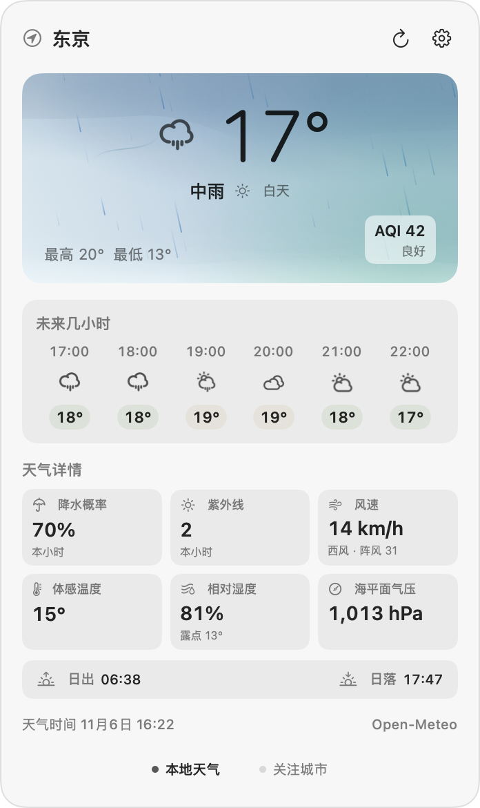
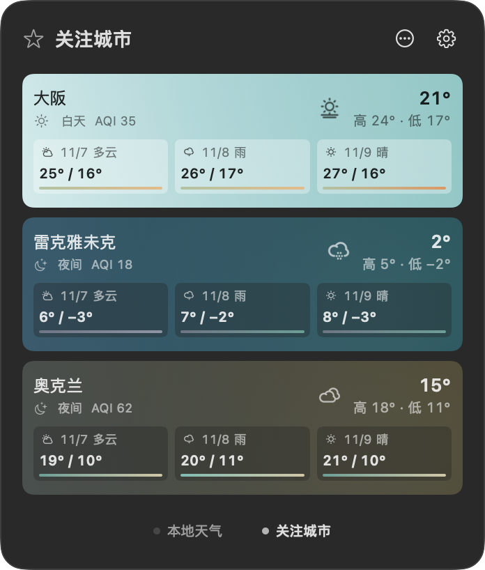

# 天气菜单栏 · Weather Menu Bar

[简体中文](#简体中文) · [English](#english)

## 简体中文

天气菜单栏是一款原生 macOS 天气工具。平时在菜单栏扫一眼，就能看到当前温度和动态天气图标。点开后，可以查看当地天气、接下来几小时的变化，以及关注城市的天气。

- **本地天气**。支持自动定位或手动选择城市，查看当天最高和最低温、未来 6 小时预报，以及降水概率、风速、湿度、体感温度和紫外线指数等。
- **天气动效**。小图标随 macOS 菜单栏外观着色。展开后，晴空、星夜、雨、雪、风和雷电有不同场景，光照随当地昼夜变化。支持关闭动画。
- **空气质量**。当地天气卡片和关注城市用色彩、AQI 数值及文字等级呈现空气质量。数据来自模型估算。
- **关注城市**。最多关注 8 个城市。横滑或点击页签，就能切换到各地当前天气、当天高低温和未来 3 天预报。
- **登录启动**。把 App 放进「应用程序」后，可在应用设置里选择是否随 macOS 登录启动。

## English

Weather Menu Bar is a native macOS weather utility. Glance at the menu bar for the current temperature and an animated weather icon. Open the panel for local conditions, the next few hours, and the cities you follow.

- **Local weather.** Use automatic location or pick a city. See today's high and low, a six-hour forecast, and details including precipitation chance, wind, humidity, feels-like temperature, and UV index.
- **Weather animations.** The menu bar icon adapts to the system appearance. The expanded panel shows distinct scenes for sunshine, starry nights, rain, snow, wind, and lightning. Lighting follows the city's day–night cycle, and animations can be turned off.
- **Air quality.** The local card and followed cities show the modeled AQI, category, and a color cue.
- **Followed cities.** Track up to eight cities. Swipe horizontally or click a tab to see current conditions, today's high and low, and a three-day forecast.
- **Launch at login.** After placing the app in Applications, you can enable or disable automatic launch in its settings.

## 截图 · Screenshots

| 本地天气 · Local weather | 关注城市 · Followed cities |
| --- | --- |
|  |  |

原生程序界面，截图使用示例天气数据。

Native app interface captured with sample weather data.

## 从源码构建 · Build from source

需要 Apple Silicon Mac、macOS 26 或更新版本，以及 Xcode 命令行工具。

Requires an Apple Silicon Mac with macOS 26 or later and the Xcode command-line tools.

```sh
./source/build.sh
open "build/1.0.1/天气菜单栏.app"
```

## 数据和许可 · Data and license

天气与空气质量由 [Open-Meteo](https://open-meteo.com/) 提供，免费接口限非商业用途。项目代码采用 [MIT](LICENSE)。第三方天气图标保留[原许可与署名](assets/temps/SOURCE.md)。

Weather and air quality are provided by [Open-Meteo](https://open-meteo.com/), whose free API is for non-commercial use. The project code is licensed under [MIT](LICENSE). Third-party weather icons retain their [original license and attribution](assets/temps/SOURCE.md).
